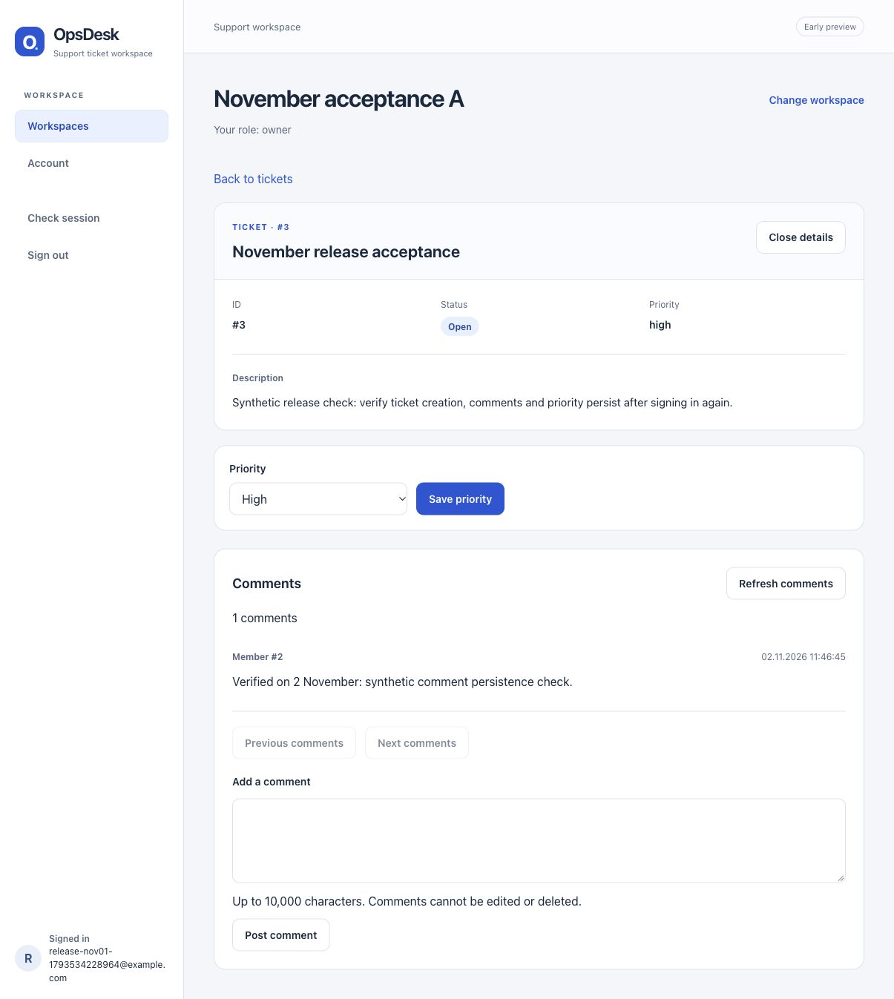

# OpsDesk

OpsDesk is a support-ticket application built with Python, FastAPI, PostgreSQL,
React and TypeScript. The backend uses organization membership to separate tenant
data. I am building it as a backend-focused portfolio project, with practical
full-stack learning documented in my
[bootcamp repository](https://github.com/ozdemirr1/ai-backend-bootcamp).

## Try the live preview

**[Open OpsDesk](https://opsdesk-production-448f.up.railway.app/)**

Verified on **2 November 2026** at runtime source `8a633d0`:
registration/login, workspace creation/selection, real Ticket creation/list/detail,
persisted comments, staff priority changes and logout/relogin work against FastAPI
and hosted PostgreSQL. Search/filter and reload were also checked on 29 October;
see the dated evidence rather than treating all checks as one fresh run.
FastAPI serves the React build and API from the same origin; Railway follows `main`.

Use a made-up email such as `your-name-demo@example.com` and a password used only
for this demo. Accounts may be reset; do not enter real customer/support data.
Tokens stay in memory, so reloading requires login again. Sign-out clears the
browser session; it is not server-side JWT revocation.

**Sign in to access your workspaces and Tickets.** A new workspace starts empty;
use New ticket to add a record. Search, status filters and pagination use the real
API. Agent/admin/owner priority controls depend on current role and Ticket state;
the server checks authorization independently. Assignment, status transitions,
membership administration and AI are not yet implemented.

Actual browser capture of runtime `8a633d0`, using a synthetic account and a
UI-created Ticket after signing out and back in. This is an early learning
preview, not a production-readiness claim. Fixture Tickets are outside product
navigation.

## Implemented and planned

| Area | Implemented now | Remaining work |
| --- | --- | --- |
| Identity | Registration, Argon2id hashing, JWT login, current active User; browser forms and in-memory session | Bounded public-demo abuse controls and provider audit review |
| Organizations | Atomic creation with owner membership; scoped list/detail and protected selection UI | Membership/role/ownership mutations |
| Tickets | Tenant-safe creation, scoped reads/search/filter/pagination, creation modal and role-aware priority API/UI | Assignment and full status workflow |
| Comments | Authorized GET/POST, pagination, form/list, scope cleanup; hosted persistence verified | Editing/deletion are outside current scope |
| Quality and deployment | Backend/frontend CI, guarded PostgreSQL tests, live same-origin preview, isolated restore and rollback-read rehearsal | PostgreSQL CI, hosted backup automation/restore verification, broader operational acceptance |
| UI and AI | React/TypeScript, Tailwind, responsive sidebar/forms/table/detail, modal, success notice, keyboard and empty/loading/error states | Dependency maintenance; AI is planned for Month 06 |

The published source has **12 business endpoints**: identity (3), Organizations
(3), Ticket creation/list/detail (3), Comment GET/POST (2) and Ticket priority PUT
(1), plus two health endpoints. They shipped through
[PR #49](https://github.com/ozdemirr1/opsdesk/pull/49); the 22-endpoint design
inventory remains a target, not a delivered count.

## Verification evidence

Separate test groups and environments; these are not a combined test total:

| Check | Result | Evidence date |
| --- | --- | --- |
| Frontend | 356 tests / 17 files; build/lint passed | 1 November release CI |
| Backend non-integration | 740 passed; Ruff passed | 1 November release CI |
| PostgreSQL data integration | 281 passed on guarded `opsdesk_product_test` | 2 November |
| Guarded schema/migration suite | 5 passed; Alembic check found no drift | 2 November |
| Recovery rehearsal | Synthetic rows and sequence values matched after dump/restore; prior runtime read succeeded | 2 November |

Source/test/hosted schema head is `84c2f9a17d60`. Hosted comment privileges were
repaired with narrow grants and rechecked; readiness alone did not detect their
absence. The last verified development schema remains `31be9023cfb2`.
Read the [recovery record and boundaries](docs/release-recovery.md),
[project status](docs/project-status.md), and
[Month 04 review](https://github.com/ozdemirr1/ai-backend-bootcamp/blob/main/monthly-reports/month-04.md).

The scoped UI and integration are delivered. Broader demo exposure remains gated
on abuse controls, provider audit review and hosted backup evidence. The 2 November
npm audit reported 16 development-tool findings (14 moderate, 2 high);
`npm audit --omit=dev` reported zero. This does not clear build-tool risk or
certify the Python dependencies. No automatic dependency upgrades were applied.

## Run locally and explore the design

- [Backend setup, configuration, database targets and test commands](docs/development.md)
- [Docker image and local verification](docs/docker.md)
- [Local Compose setup and verification](docs/compose.md)
- [Frontend setup, architecture and browser checks](frontend/README.md)
- [Requirements](docs/requirements.md), [domain model](docs/domain-model.md),
  [relational model](docs/relational-model.md) and [ERD](docs/erd.md)
- [API contract](docs/api-contract.md), [access rules](docs/access-control.md),
  [Ticket lifecycle](docs/ticket-lifecycle.md) and [concurrency contract](docs/concurrency-contract.md)
- [Published backlog and original scope](docs/issue-plan.md)
- [Week 16 integration/UI plan](https://github.com/ozdemirr1/ai-backend-bootcamp/blob/main/weekly-reports/week-16-plan.md)

Local product databases are `opsdesk_product_dev` and `opsdesk_product_test`.
The older bootcamp databases `opsdesk_dev` / `opsdesk_test` are separate learning
artifacts. Never run destructive tests against development or the hosted demo.

Organization/Ticket HTTP adapters validate responses at runtime and serve the
protected workspace screens. The protected workspace flow shipped in PR #47; creation, comments and priority
shipped in PR #49 and passed the 2 November hosted persistence check. See
[project status](docs/project-status.md) for dated evidence and remaining gates.

The multi-stage image now packages the existing frontend and runs non-root,
with local static-file and health checks. Docker build CI now runs alongside
the existing backend/frontend workflows; controlled failure and recovery are
documented in the [Docker guide](docs/docker.md). Next: Week 17 review and handoff.
Compose, Redis and Celery remain subsequent Month 05 work;
AI summarization, priority/category suggestions and evaluations remain Month 06.
The broader backend release issue R01 is still open: this smaller workspace preview
does not fulfill its complete feature and operational acceptance criteria.
