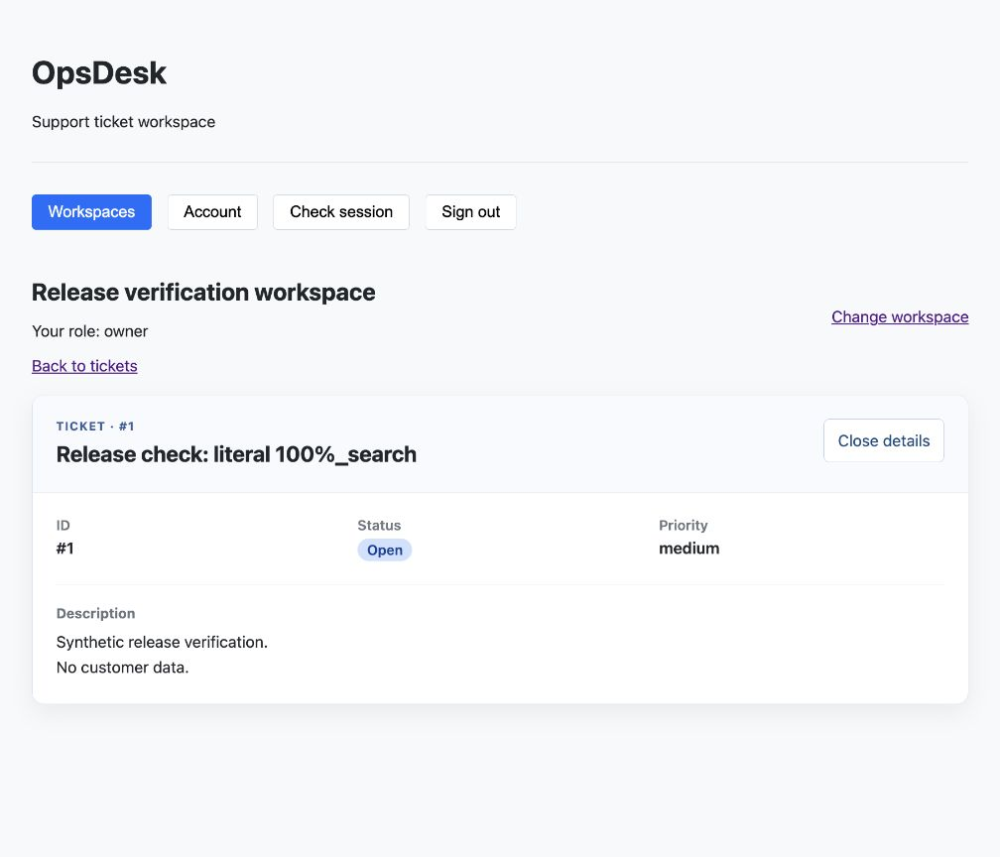

# OpsDesk

OpsDesk is a support-ticket application built with Python, FastAPI, PostgreSQL,
React and TypeScript. The backend uses organization membership to separate tenant
data. I am building it as a backend-focused portfolio project, with practical
full-stack learning documented in my
[bootcamp repository](https://github.com/ozdemirr1/ai-backend-bootcamp).

## Try the live preview

**[Open OpsDesk](https://opsdesk-production-448f.up.railway.app/)**

Verified on **29 October 2026** after deployment of the 28 October work:
registration, login, workspace creation/selection and real Ticket list/detail work
against the FastAPI backend and hosted PostgreSQL database. FastAPI serves the
React build and API from the same origin on Railway; deployment follows `main`.

Use a made-up email such as `your-name-demo@example.com` and a password used only
for this demo. Accounts may be reset; do not enter real customer/support data.
Tokens stay in memory, so reloading requires login again. Sign-out clears the
browser session; it is not server-side JWT revocation.

**Sign in to access your workspaces and Tickets.** Search, status filters and
pagination use the real API. A new workspace starts empty: Ticket creation is
currently available through the API, with its UI still pending. Comments,
workflow actions and AI are not available in the interface yet.

Actual browser capture of runtime source `2013248`, using a synthetic account and
API-created test Ticket. This is a learning preview, not a production-readiness
claim. The older public fixture dashboard is no longer in product navigation.

## Implemented and planned

| Area | Implemented now | Remaining work |
| --- | --- | --- |
| Identity | Registration, Argon2id password hashes, JWT login, persisted active User resolution; browser forms/session handling | Bounded public-demo abuse controls and further operational verification |
| Organizations | Atomic creation with owner membership; scoped list/detail API and hosted selection/creation UI | Membership/role/ownership mutations |
| Tickets | Tenant-consistent schema, creation and scoped list/detail APIs with title search/filter/pagination; hosted protected real-data table/detail | Creation UI, assignment, priority changes, status workflow, comments |
| Comments | Deployed storage; locally implemented authorized GET/POST API, content normalization, ordered locks and rollback/concurrency tests | Review/CI/deployment of the new API; CommentForm/list integration |
| Quality and deployment | Backend/frontend CI; guarded local PostgreSQL tests; live same-origin preview and health endpoints | PostgreSQL CI, isolated restore/rollback evidence, broader release gates |
| UI and AI | Typed components, accessible table semantics, focus handling and basic CSS | Week 16 full Month 04 UI package; AI planned for Month 06 |

The Week 16 backend has nine deployed business endpoints: `POST /users`,
`POST /auth/login`, `GET /users/me`, `POST /organizations`, `GET /organizations`,
`GET /organizations/{organization_id}` and
`POST /organizations/{organization_id}/tickets`,
`GET /organizations/{organization_id}/tickets` and
`GET /organizations/{organization_id}/tickets/{ticket_id}`, plus two health endpoints.
The Week 16 reads are deployed and verified through the hosted UI.
Two additional Comment routes (GET/POST on
`/organizations/{organization_id}/tickets/{ticket_id}/comments`) are implemented
and tested locally on 29 October, bringing the source total to eleven; these
new routes have not been published or deployed.
The 22-endpoint design inventory describes the target, not the implemented API.

## Verification evidence

These are separate, dated test groups, not a combined current-run total:

| Check | Last recorded local result | Date |
| --- | --- | --- |
| Frontend | 234 tests across 12 files; build and lint passed | 28 October |
| Backend non-integration | 702 passed; 242 database/schema tests deselected; Ruff passed | 29 October |
| PostgreSQL data integration | 237 passed on guarded `opsdesk_product_test` | 29 October |
| Guarded schema/migration suite | 5 passed | 28 October |

The 26 October frontend retry used one worker after an initial disk-space error;
see the [baseline and contract preparation](docs/issues/f11.md#week-16-implementation-ready-contract--26-october-2026).
Ticket reads/search are implemented and locally tested; see the
[implementation evidence](docs/issues/f11.md#week-16-local-implementation--26-october-2026).
The 28 October Comment foundation adds revision `84c2f9a17d60`; its guarded
migration tests and metadata check pass. The test database and hosted deployment
are upgraded; the last verified local development schema remains `31be9023cfb2`.

Week 15 merged through [PR #43](https://github.com/ozdemirr1/opsdesk/pull/43).
[Backend CI](https://github.com/ozdemirr1/opsdesk/actions/runs/40193369253) and
[Frontend CI](https://github.com/ozdemirr1/opsdesk/actions/runs/40193369467)
passed at merge commit `122c052`. Backend CI excludes PostgreSQL tests.
The deployed source verified on 25 October was `255f937`; both health endpoints
returned 200 then. The newer runtime `2013248` passed hosted smoke on 29 October.
Full evidence, limitations and issue closures are in [project status](docs/project-status.md).

## Run locally and explore the design

- [Backend setup, configuration, database targets and test commands](docs/development.md)
- [Frontend setup, architecture and browser checks](frontend/README.md)
- [Requirements](docs/requirements.md), [domain model](docs/domain-model.md),
  [relational model](docs/relational-model.md) and [ERD](docs/erd.md)
- [API contract](docs/api-contract.md), [access rules](docs/access-control.md),
  [Ticket lifecycle](docs/ticket-lifecycle.md) and [concurrency contract](docs/concurrency-contract.md)
- [Published backlog and original scope](docs/issue-plan.md)
- [Week 16 integration/UI plan](https://github.com/ozdemirr1/ai-backend-bootcamp/blob/main/weekly-reports/week-16-plan.md)

Local product databases are `opsdesk_product_dev` and `opsdesk_product_test`.
The older bootcamp databases `opsdesk_dev` / `opsdesk_test` are separate learning
artifacts. Never run destructive tests against development or the hosted demo.

Organization/Ticket HTTP adapters validate responses at runtime and serve the
protected workspace screens. The real PostgreSQL/browser walkthrough passed
locally on 28 October and on the hosted preview on 29 October.
[PR #47](https://github.com/ozdemirr1/opsdesk/pull/47) merged as `2013248` with passing
Backend/Frontend CI and successful Railway deployment. See [project status](docs/project-status.md).

Next: review/publish the local Comment API and connect its form/list, a role-aware priority action and the
full Month 04 UI package. The revised Week 16 plan allocates 42 focused hours plus
up to 8 contingency hours; these are targets, not shipped features. Docker/Redis remain Month 05;
AI summarization, priority/category suggestions and evaluations remain Month 06.
The broader backend release issue R01 is still open: this smaller workspace preview
does not fulfill its complete feature and operational acceptance criteria.
