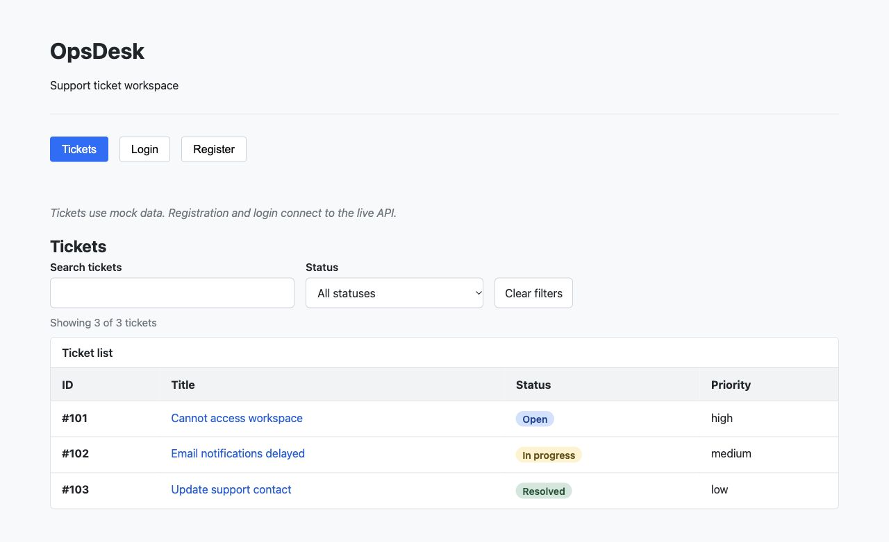

# OpsDesk

OpsDesk is a support-ticket application built with Python, FastAPI, PostgreSQL,
React and TypeScript. The backend uses organization membership to separate tenant
data. I am building it as a backend-focused portfolio project, with practical
full-stack learning documented in my
[bootcamp repository](https://github.com/ozdemirr1/ai-backend-bootcamp).

## Try the live preview

**[Open OpsDesk](https://opsdesk-production-448f.up.railway.app/)**

Rechecked on **28 October 2026**, registration through the API and browser login, session checking and sign-out work
against the FastAPI backend and hosted PostgreSQL database.
FastAPI serves the React build and API from the same origin on Railway.

Use a made-up email such as `your-name-demo-25@example.com` and a password used
only for this demo. Accounts may be reset; do not enter real customer/support data.
Tokens stay in memory, so reloading requires login again. Sign-out clears the
browser session; it is not server-side JWT revocation.

**The hosted Ticket dashboard is explicitly labelled mock data.** Search, status filtering
and details use three synthetic records. It is an early identity-flow preview;
hosted real Ticket UI integration, comments, workflow actions and AI are not delivered yet.

Actual browser capture of deployed source `255f937`; no product mockup or generated
interface. The preview is a learning deployment, not a production-readiness claim.

Locally, the 28 October interface opens Login before authentication and removes
fixture Tickets from normal navigation. Real workspaces and Ticket reads are
verified against local PostgreSQL; that increment is not deployed yet.

## Implemented and planned

| Area | Implemented now | Remaining work |
| --- | --- | --- |
| Identity | Registration, Argon2id password hashes, JWT login, persisted active User resolution; browser forms/session handling | Bounded public-demo abuse controls and further operational verification |
| Organizations | Atomic creation with owner membership; scoped list/detail API and local selection/creation UI | Membership/role/ownership mutations; hosted verification of the new UI |
| Tickets | Tenant-consistent schema, creation and scoped list/detail APIs with title search/filter/pagination; older hosted mock preview; locally verified protected real-data table/detail | Hosted integration verification, creation UI, assignment, priority changes, status workflow, comments |
| Comments | Tenant-consistent schema/model and scoped repository verified on the test database | Service authorization, input normalization, cooperating locks, HTTP API and form |
| Quality and deployment | Backend/frontend CI; guarded local PostgreSQL tests; live same-origin preview and health endpoints | PostgreSQL CI, isolated restore/rollback evidence, broader release gates |
| UI and AI | Typed components, accessible table semantics, focus handling and basic CSS | Week 16 full Month 04 UI package; AI planned for Month 06 |

The Week 16 backend now exposes nine business endpoints: `POST /users`,
`POST /auth/login`, `GET /users/me`, `POST /organizations`, `GET /organizations`,
`GET /organizations/{organization_id}` and
`POST /organizations/{organization_id}/tickets`,
`GET /organizations/{organization_id}/tickets` and
`GET /organizations/{organization_id}/tickets/{ticket_id}`, plus two health endpoints.
The new reads belong to Week 16; the last verified live preview runs the Week 15 source.
The 22-endpoint design inventory describes the target, not the implemented API.

## Verification evidence

These are separate, dated test groups, not a combined current-run total:

| Check | Last recorded local result | Date |
| --- | --- | --- |
| Frontend | 234 tests across 12 files; build and lint passed | 28 October |
| Backend non-integration | 589 passed; 209 database/schema tests deselected; Ruff passed | 28 October |
| PostgreSQL data integration | 204 passed on guarded `opsdesk_product_test` | 28 October |
| Guarded schema/migration suite | 5 passed | 28 October |

The 26 October frontend retry used one worker after an initial disk-space error;
see the [baseline and contract preparation](docs/issues/f11.md#week-16-implementation-ready-contract--26-october-2026).
Ticket reads/search are implemented and locally tested; see the
[implementation evidence](docs/issues/f11.md#week-16-local-implementation--26-october-2026).
The 28 October Comment foundation adds revision `84c2f9a17d60`; its guarded
migration tests and metadata check pass. Only the test database was upgraded;
local development and the last verified hosted schema remain at `31be9023cfb2`.

Week 15 merged through [PR #43](https://github.com/ozdemirr1/opsdesk/pull/43).
[Backend CI](https://github.com/ozdemirr1/opsdesk/actions/runs/40193369253) and
[Frontend CI](https://github.com/ozdemirr1/opsdesk/actions/runs/40193369467)
passed at merge commit `122c052`. Backend CI excludes PostgreSQL tests.
The deployed source verified on 25 October was `255f937`; both health endpoints
returned 200 then. The deployed SHA was not independently retrieved on 28 October.
Full evidence, limitations and issue closures are in [project status](docs/project-status.md).

## Run locally and explore the design

- [Backend setup, configuration, database targets and test commands](docs/development.md)
- [Frontend setup, architecture and browser checks](frontend/README.md)
- [Requirements](docs/requirements.md), [domain model](docs/domain-model.md),
  [relational model](docs/relational-model.md) and [ERD](docs/erd.md)
- [API contract](docs/api-contract.md), [access rules](docs/access-control.md),
  [Ticket lifecycle](docs/ticket-lifecycle.md) and [concurrency contract](docs/concurrency-contract.md)
- [Published backlog and original scope](docs/issue-plan.md)
- [Week 16 integration/UI plan](https://github.com/ozdemirr1/ai-backend-bootcamp/blob/main/weekly-reports/week-16-plan.md)

Local product databases are `opsdesk_product_dev` and `opsdesk_product_test`.
The older bootcamp databases `opsdesk_dev` / `opsdesk_test` are separate learning
artifacts. Never run destructive tests against development or the hosted demo.

Organization/Ticket HTTP adapters now validate responses at runtime and serve
the local protected workspace screens (27 October). Public preview Tickets remain
mock-backed. The focused backend read tests also passed all 77 cases on 27 October.

The actual local PostgreSQL/browser walkthrough passed on 28 October. Yesterday’s
branch `0b28946` passed Backend/Frontend CI; no PR exists yet. Today’s navigation
corrections and Comment persistence foundation are uncommitted. See [project status](docs/project-status.md).

Next: publish and verify the complete private flow on the
hosted deployment, then persisted comments, a role-aware priority action and the
full Month 04 UI package. The revised Week 16 plan allocates 42 focused hours plus
up to 8 contingency hours; these are targets, not shipped features. Docker/Redis remain Month 05;
AI summarization, priority/category suggestions and evaluations remain Month 06.
The broader backend release issue R01 is still open: this smaller identity preview
does not fulfill its complete feature and operational acceptance criteria.
